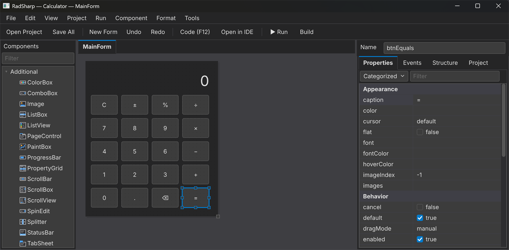
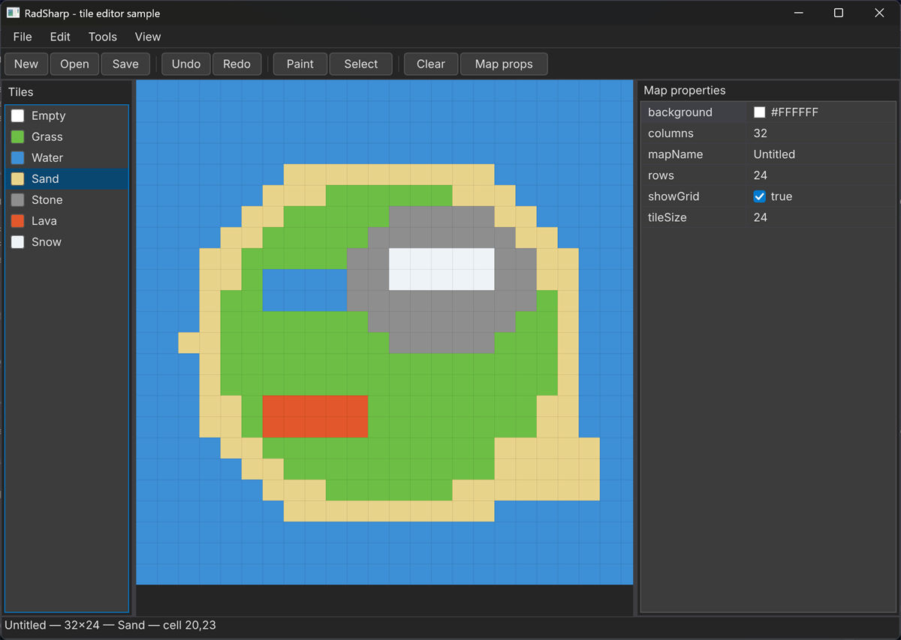
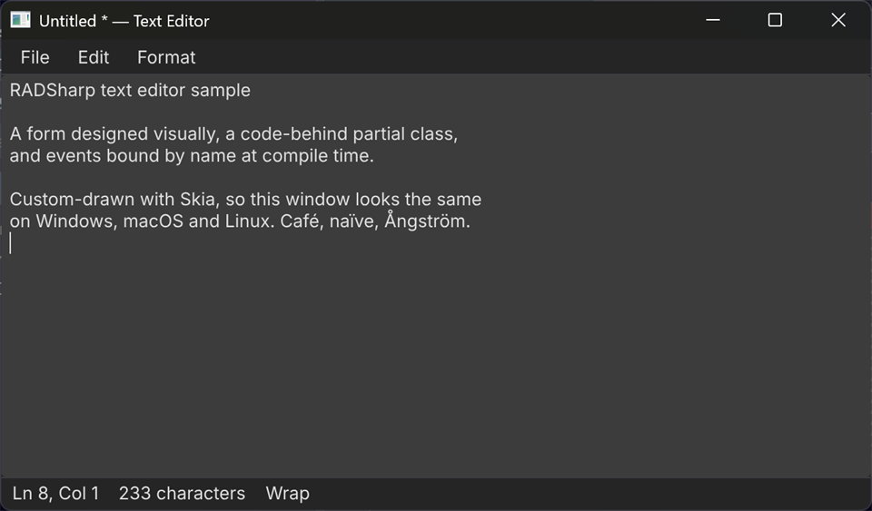
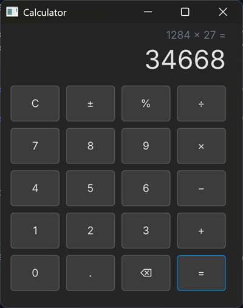
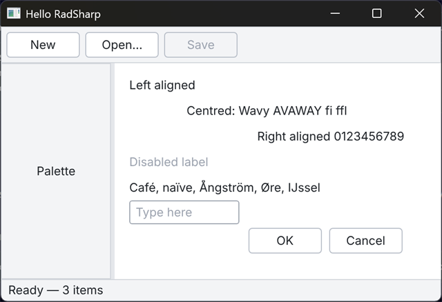
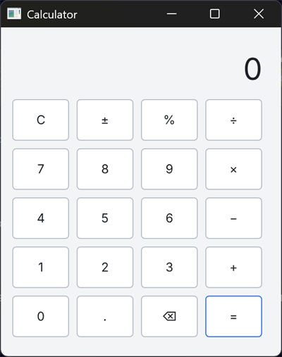
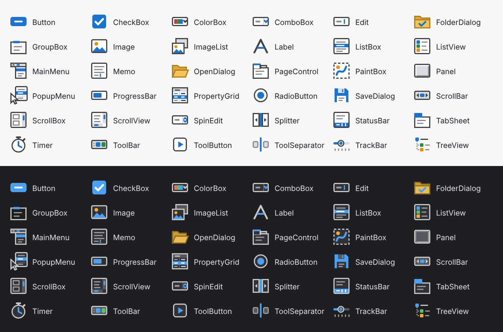

# RadSharp

**Delphi-style rapid application development for C#.** Draw a form, double-click a button to write its handler, press
**F9** to run it live, and press **Build** for a small native executable. Runs on Windows, macOS and Linux.



## Why RadSharp

- **The Delphi workflow in C#.** Forms use Align + Anchors layout. An Object Inspector edits their published
  properties. Each form file sits next to a code-behind partial class, and events bind to handlers by name at compile
  time, so a missing handler is a compile error rather than a runtime surprise.
- **Pixel-identical on every OS.** Controls are custom-drawn by Skia on the CPU with bundled fonts, so a form looks
  the same on Windows, macOS and Linux. Golden-image tests enforce this.
- **Native, self-contained output.** `dotnet publish` produces a NativeAOT executable of about 3–4 MB, plus the SDL3,
  Skia and HarfBuzz libraries. Users install no runtime, and there is no IL to decompile.
- **A designer built with itself.** The designer is a RadSharp application, so every control it uses is one you can
  put on your own forms.
- **Design inside Visual Studio too.** A Visual Studio 2022/2026 extension opens `.radform.json` files in a
  `[Design]` tab with its own Toolbox and Properties windows, much like the WinForms designer.
- **Light and dark themes,** in the designer and in your apps.

## Screenshots

### Visual Studio integration

The same designer inside Visual Studio 2022, docked like the WinForms designer. Double-clicking a control writes its
event handler in the C# editor.

![The RadSharp designer in a Visual Studio [Design] tab with the RadSharp Toolbox and Properties windows](docs/images/visual-studio-dark.png)

### Built with RadSharp

The samples in [`samples/`](samples), shown in the dark theme:



<p>
  
  
</p>

The default light theme:

<p>
  
  
</p>

### Toolbox

Every component has a vector icon that stays sharp at any scale and follows the theme.



## Quick start

You need the [.NET 10 SDK](https://dotnet.microsoft.com/download).

```sh
dotnet run --project src/RadSharp.Designer    # the designer
dotnet run --project samples/TileEditor       # a sample app
dotnet test                                   # the test suite
```

> **Note:** NuGet currently flags the `Microsoft.DotNet.ILCompiler` package that NativeAOT uses as vulnerable, and the
> samples treat that warning as an error. Until the package is updated, add `-p:NuGetAudit=false` to `dotnet build`,
> `dotnet run` and `dotnet test`.

To start your own app, follow [docs/getting-started.md](docs/getting-started.md). It packs the
[`templates/`](templates) project, installs it, and creates a new app with `dotnet new radsharp-app -n MyApp`.

## The Visual Studio designer

The extension lives in [`vs/`](vs). It is a thin .NET Framework 4.8 layer, which is what Visual Studio runs on. The
designer itself runs in a separate .NET 10 process (`src/RadSharp.DesignHost`) and streams its picture to Visual Studio,
as Avalonia's previewer does.

1. Build the `.vsix` with Visual Studio 2022's MSBuild (`dotnet build` can't produce one):
   ```
   cd vs
   "C:\Program Files\Microsoft Visual Studio\2022\Community\MSBuild\Current\Bin\MSBuild.exe" -restore RadSharp.VisualStudio.slnx -p:Configuration=Release
   ```
2. Close Visual Studio, then double-click
   `vs\RadSharp.VisualStudio\bin\Release\net48\RadSharp.VisualStudio.vsix` and pick Visual Studio 2022 or 2026.
3. Open any `.radform.json` file. If it opens as plain JSON, run `devenv /updateconfiguration` once and restart
   Visual Studio.

The design, protocol and test checklist are in [docs/vs-designer-plan.md](docs/vs-designer-plan.md).

## Repository layout

| Path | What's there |
|---|---|
| `src/RadSharp.Core` | Controls, layout, rendering, text, form reader/writer, component metadata |
| `src/RadSharp.Generators` | Source generators for component metadata and form code-behind |
| `src/RadSharp.Platform.Sdl` | The SDL3 host: windows, input, IME, clipboard, dialogs, modal loops |
| `src/RadSharp.Design` | The design surface, document model, palette and toolbox icons, menu and tab-order editors |
| `src/RadSharp.Design.Code` | Roslyn integration: handler stubs, renames, live run (F9), builds |
| `src/RadSharp.Designer` | The standalone designer app (itself a RadSharp form) |
| `src/RadSharp.DesignHost` | The headless design host behind the Visual Studio designer, and its pipe protocol |
| `vs/` | The Visual Studio extension and its WPF client |
| `samples/` | Hello, Calculator, TextEditor, SettingsDialog and TileEditor |
| `spec/` | Conformance vectors for layout and form files |
| `templates/` | The `dotnet new radsharp-app` template |

## Status

All roadmap milestones M0–M9 are implemented, and hardening milestones are under way (see
[RadSharp-roadmap.md](RadSharp-roadmap.md)). RadSharp is a young codebase: it is developed and tested on Windows, and
macOS and Linux run in CI. Known gaps and the plan to close them are in [docs/gap-analysis.md](docs/gap-analysis.md),
[docs/gap-plan.md](docs/gap-plan.md) and [docs/designer-gap-analysis.md](docs/designer-gap-analysis.md).

## Documentation

- [Getting started](docs/getting-started.md)
- [Control reference](docs/controls.md)
- [Form file and layout spec](docs/spec.md)
- [Distribution and NativeAOT publishing](docs/distribution.md)
- [Visual Studio designer](docs/vs-designer-plan.md)
- [Design background](future-framework-brainstorm.md)

## License

RadSharp is released under the [MIT License](LICENSE).

The bundled Inter font is under the SIL Open Font License 1.1
([`src/RadSharp.Core/Fonts/Inter-LICENSE.txt`](src/RadSharp.Core/Fonts/Inter-LICENSE.txt)).
