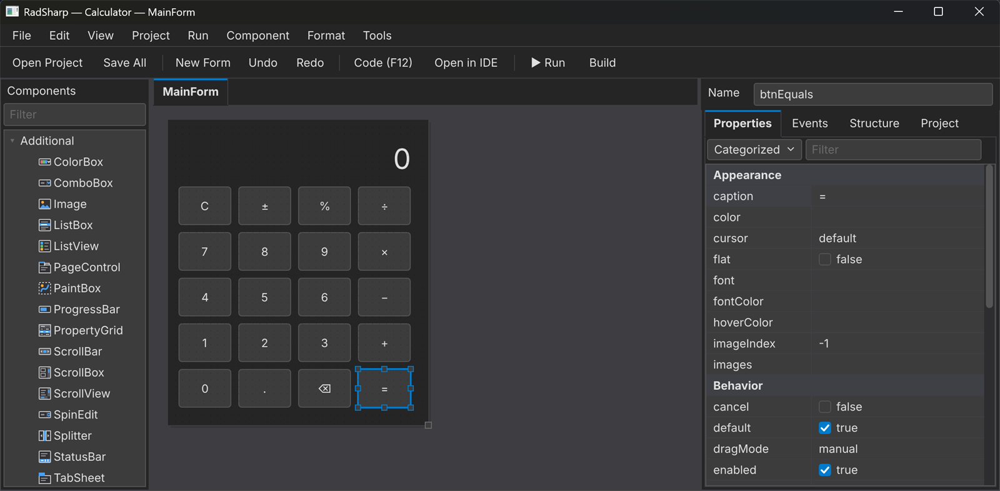

# RadSharp

**Delphi-style rapid application development for C#.** Draw a form, double-click a button to write its handler, press
**F9** to run it live, and press **Build** for a small native executable. Runs on Windows, macOS and Linux.



> **Preview.** This is a 0.x pre-release. APIs may still change before 1.0. Form files (`*.radform.json`, format
> version 1.0) that this preview writes will keep loading in 1.0.

## Packages

| Package | What it is |
|---|---|
| `RadSharp.Core` | Controls, Align + Anchors layout, Skia rendering, form files and the form source generator |
| `RadSharp.Platform.Sdl` | The SDL3 host: windows, input and the event loop. Reference this one; it brings `RadSharp.Core` |
| `RadSharp.Templates` | `dotnet new radsharp-app` |

## Start an app

You need the [.NET 10 SDK](https://dotnet.microsoft.com/download), 10.0.404 or later.

```sh
dotnet new install RadSharp.Templates::0.1.0-preview.1
dotnet new radsharp-app -n MyApp
cd MyApp
dotnet run                       # run it
dotnet publish -c Release        # a NativeAOT executable for this OS
```

The designer (Windows, macOS, Linux) and the Visual Studio extension are on the
[GitHub release page](https://github.com/SantasLair/RadSharp/releases).

## Learn more

- [Getting started](https://github.com/SantasLair/RadSharp/blob/main/docs/getting-started.md)
- [Control reference](https://github.com/SantasLair/RadSharp/blob/main/docs/controls.md)
- [Binding and actions](https://github.com/SantasLair/RadSharp/blob/main/docs/binding-and-actions.md)
- [Distribution and NativeAOT publishing](https://github.com/SantasLair/RadSharp/blob/main/docs/distribution.md)
- [Known limits](https://github.com/SantasLair/RadSharp/blob/main/docs/known-limits.md)

MIT licensed. The bundled Inter font is under the SIL Open Font License 1.1.
